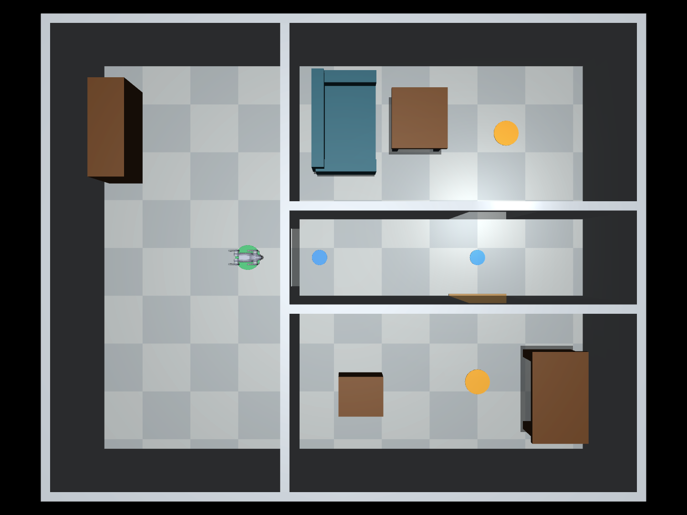

# Go2 MuJoCo Simulation

The [V5 close-spacing repair](docs/agents/v5_close_validation.md) completes both
previously refused 1.8 m and 2.0 m three-bar courses using the same frozen
model and jump profile. Shape-aware landing clearance also passed 12/12 fresh
close courses with 36 verified jumps and no contact/fall. Run
`python -m experiments.obstacle_v5_close.run --viewer --viewer-speed .5`.
The 0.15 m landing margin and physical collision checks remain enforced.

The [V5 multi-obstacle extension](docs/agents/v5_multi_validation.md) performs
repeated observed-count jumps and goal stopping in one persistent episode.
It completed 9/9 held-out two-, three- and four-bar courses (27 jumps), plus
the three-bar demo, without contacts/falls. Two closer-spacing courses were
refused by the landing guard. Run
`python -m experiments.obstacle_v5_multi.run --viewer --viewer-speed .65`.
The viewer shows the skill and cleared-bar count. A separate association bank
extends V5; its encoder, motor profile and original packages remain unchanged.

The [V5 reliability refinement](docs/agents/v5_refinement_validation.md) fixes
the four refusals and rear-thigh contact, and completes 40/40 fresh paired
courses versus original V5's 31/40, with no refined contact/fall or lost
success. All 211 tests passed. Watch the formerly contacting course with
`python -m experiments.obstacle_v5_refinement.run --viewer --video --viewer-speed .5`.
It uses a separate landing profile and finer outcome associations while
preserving the original models and actuator bounds.

The [V5 walk-up experiment](docs/agents/approach_low_bar_v5_validation.md) now
walks toward a low bar, brakes into a supported stance, selects a jump from
SNN counts and continues to its goal in one episode. Run
`python -m experiments.obstacle_v5.run --viewer --video --viewer-speed .5`.
It completed 15/20 fresh courses, with four refusals and one jump contact;
all 204 tests passed. Approach/braking is classical range control; the jump
association bank is learned. V3/V4 and the jump motor profile remain unchanged.

The opt-in [V4 low-bar experiment](docs/agents/autonomous_low_bar_v4_validation.md)
selects a jump from obstacle observations without an explicit jump request,
then resumes V3 walking and goal stopping in one physics episode. It passed
18/20 held-out low bars with two learned refusals and no contact/fall. Start
the finite demo with `python -m experiments.obstacle_v4.run --viewer --video`.
It starts in a restricted, tested launch stance; camera perception and walking
up to distant bars remain future work.

The [terrain and goal experiment](docs/agents/terrain_goal_validation.md) improves
the original transfer course from 0/60 to **44/60**, matching its rule control.
The frozen 64-neuron goal readout adds confirmed stopping and release while
resetting spike packets independently. Fresh noisy goal tests passed 76/100
with 2 cm pose noise and 69/100 with 5 cm noise. Terrain and localization
failures remain documented; all 194 project tests passed. Run the opt-in demo
with `python -m experiments.terrain_goal.demo --scene steps --viewer --video`.

A subsequent request-readout refinement preserves the encoder and motors while
improving fresh clean goals from 78/100 to **83/100**, and noisy goals from
30/40 to **31/40**. It preserves the previous successful regression cases.
Use `--model docs/agents/terrain_goal_v3/primary.npz` with the terrain/goal demo
to select this retained experimental revision. Known calf contacts and biased
goal observations remain unresolved.

Watch V3 change skills within one four-obstacle episode with
`python -m experiments.terrain_goal.obstacle_demo --viewer --video`.
It waits for moving obstacles, walks, executes an explicitly requested short
hop, resumes walking and stops at the goal without resetting physics.

The [continuous SNN update](docs/agents/continual_snn_validation.md) learns
spike-count-to-skill associations and changes skills within one persistent
episode. Fresh stress success improved from 60/80 to 70/80 with the encoder
and decoder unchanged; regular/noisy confirmation passed 80/80 and 32/32.
That earlier model scored 0/60 on terrain/goal transfer. Watch its validated
simulation default with `python -m experiments.continual_snn.demo --viewer --video`.

An [experimental low-bar jump](docs/agents/obstacle_jump_validation.md) now clears
a 4 cm-high obstacle in a recorded 65 cm standing jump. Run
`python -m experiments.obstacle_jump --output output/obstacle_jump/my-demo --viewer --video`.
Nearby +X tests passed 14/16; landing contacts remain, and this skill is not an
SNN action.

The [120-condition jump stress assessment](docs/agents/jump_stress_validation.md)
records flat, friction, slope, step, obstacle and interruption outcomes with the
forward-hop profile frozen. It separates setup failures and refused starts from
executed jumps; slippery ground and moving-obstacle recovery remain weaknesses.

The [smooth forward-jump update](docs/agents/smooth_forward_jump_validation.md)
adds continuous takeoff/retraction/recovery targets and a short forward hop.
Watch it with `python -m experiments.smooth_jump --viewer --video`.
The learned-model demo now uses this profile by default; `--jump-profile legacy`
replays the earlier in-place hop.

The [expanded outcome-learning experiment](docs/agents/expanded_association_validation.md)
adds a saved 94-example association bank and a terrain-aware frozen encoder.
Watch its learned flat run, gentle ramp crossing and requested hop with
`python -m experiments.spike_pattern_skills.run_learned --viewer`. The finite
demo records neural activity, actual actions and outcomes.

A [gradual terrain curriculum](docs/agents/terrain_curriculum_validation.md)
adds 60 configurations across ten levels, from thresholds and ramps to steps,
uneven surfaces, friction changes and moving obstacles. It records execution
and enforces optional difficulty gates; these runs assess frozen controllers.
Launch a diagnostic viewer with `python -m experiments.spike_pattern_skills.run_curriculum --stages 1 2 3 --variants 0 --modes direct_run --viewer`.

Two [imported Go2 velocity policies](docs/agents/pretrained_velocity_validation.md)
now provide seven validated forward/reverse/lateral/turning command options.
Discover them with `python -m skills.registry`, or view one with
`python -m skills.pretrained_velocity --policy himloco --skill forward --viewer`.
Their 36-trial comparison retains failed options as unavailable; they have not
been added as new SNN output classes.

For a consolidated account of completed work, recorded results, artifact
availability and remaining work, see the [project progress summary](docs/project_summary.md)
(October 16, 2026).

An [experimental pretrained gap-jump adapter](docs/agents/pretrained_jump.md)
now runs a published Go2 policy with real terrain scans. Transfer tests failed
all seven gap conditions under the existing torque limits, so the tested
in-place hop remains the default. The report includes a MuJoCo viewer command.

A project for simulating the Unitree Go2 quadruped in MuJoCo, with classical
goal tracking and a trained spiking network that selects obstacle-avoidance
skills. Start with **[Go2_hybrid.ipynb](Go2_hybrid.ipynb)** and the
[hybrid guide](docs/hybrid_system.md). See [measured results](docs/hybrid_validation.md)
for the baseline/rules/SNN comparison and known limitations.

The [run/jump and spiking-output experiment](docs/agents/skill_lif_validation.md)
adds a fast trot, an in-place hop, a 252-attempt simulation CSV dataset and a
trained LIF model with separate wait/run/jump output neurons. Data is under
`output/skill_lif/dataset/`; the experimental model is under
`output/skill_lif/model/`. See the report for collection, training and execution
commands and the distinction between primitive completion and task success.

For the full development story, architecture, experiments, fixes and run
instructions, see [Project history](PROJECT_HISTORY.md).

For faster walking, a six-metre route, and plots of every SNN decision, see
[Faster motion and brain signals](docs/faster_motion_and_brain.md).

To adjust observations and watch neural scores, safety masks and neuron
signals respond, launch the [interactive SNN inspector](docs/snn_inspector.md).

To watch actual robot motion beside those signals, launch the
[live simulation dashboard](docs/live_dashboard.md) with `python -m hybrid.live`.
The [complex-obstacle upgrade](docs/complex_obstacles_and_neural_ui.md) adds
crates, moving/reversing barriers, faster scene checks and neural readout evidence.

## Setup

1. Clone or download this repository.
2. Open a terminal in the project folder.
3. Create and activate a Python virtual environment for your operating system.
4. Install all dependencies:

   python -m pip install -r requirements.txt

5. Launch the simulation:

   python -m mujoco.viewer --mjcf unitree_go2/scene.xml

On macOS, use `mjpython` instead of `python` for the viewer command.

## Indoor environment

With the environment activated, run:

```sh
python indoor_demo.py
```

This loads `unitree_go2/scene_indoor.xml` and holds Go2 in its home posture
using a simple joint PD controller with actuator torque limits. It does not walk,
navigate, or implement the proposal's baseline navigation controller. On macOS,
use `mjpython indoor_demo.py`.



The 10 m x 8 m interior contains an entry room, a 1.6 m wide corridor,
a lounge with a sofa and table, and an office with a desk and box. Doorways
are 1.2 m wide and 2.1 m high. Walls are 2.4 m high; there is no ceiling so
the interior is visible from above. All furniture is fixed collision geometry.
The office doorway has a 2 cm threshold for a later step-crossing test.
Surface friction is a simulation starting value, not a measured floor material.

Green marks the start, blue marks intermediate waypoints, and yellow marks goals.
These are named MuJoCo sites with no collisions:

| Site | Position (x, y) in metres |
| --- | --- |
| `start` | (0, 0) |
| `waypoint_entry` | (1.5, 0) |
| `waypoint_corridor` | (4.8, 0) |
| `goal_lounge` | (5.4, 2.6) |
| `goal_office` | (4.8, -2.6) |

For the lounge route, travel along the corridor to (4.8, 0), turn through the
door to (4.8, 2.6), then approach the goal. For the office, turn south at
(4.8, 0). The waypoint controller below can execute specified routes; the
indoor posture demo itself does not execute a navigation task.
Edit named geoms and sites in `scene_indoor.xml` to change the layout.
MJCF box `size` values are half extents. The original flat-ground and MJX scenes
remain available; this indoor scene currently includes the MJX Go2 model.

To open the raw scene without the posture controller:

```sh
python -m mujoco.viewer --mjcf unitree_go2/scene_indoor.xml
```

The raw viewer does not supply standing torques, so the robot can collapse when
physics runs. For repeatable checks without a window:

```sh
python indoor_demo.py --headless
python -m unittest discover -s tests -v
```

Checks cover posture, collision response, waypoint navigation, SNN inference,
sensor stress models and hybrid handoffs. The original indoor checks alone
cover geometry and posture; the newer tests exercise locomotion and navigation.
See [project assessment](docs/project_status.md) for progress against the proposal.

## Model source

The Go2 model is from [Google DeepMind's MuJoCo Menagerie](https://github.com/google-deepmind/mujoco_menagerie/tree/main/unitree_go2).
Its BSD-3-Clause license is included in `unitree_go2/LICENSE`.

## Spiking obstacle-avoidance system

For the newer obstacle-avoidance experiment, open **`Go2_hybrid.ipynb`** or run:

```powershell
.\.venv-win\Scripts\python.exe -m hybrid.run --scenario crossing
```

The trained spiking network selects a bypass, wait or back-off skill, then
returns to classical goal tracking. Joint torque PID remains active throughout.
Use `--headless` for a fast run, `--scenario static` for a bypass, or
`--config configs/hybrid_example.json` to change start, destination and obstacles.
See [the hybrid guide](docs/hybrid_system.md) for setup, controls, retraining and
limitations, and [validation results](docs/hybrid_validation.md) for comparisons.
The SNN weights and metadata are saved under `skills/policies/selector_snn/`.
This is a simulation prototype with ground-truth obstacle sensing.

For the optional across-observation memory experiment and expanded hold skills,
see the [memory experiment report](docs/agents/integration_validation.md),
[skill catalog](docs/agents/skill_catalog.md), and
[SNN research brief](docs/agents/snn_research.md). The comparison retains the
existing checkpoint and contrasts retained versus reset neuron membranes;
it does not train a new recurrent policy.

Experimental preemption handles a second moving obstacle entering an executing
bypass: `python -m hybrid.run --scenario late_crossing --replan`. Set
`REPLAN = True` in the notebook to enable the same behavior. This mode has
separate validation results and retains the simulator clearance stop.

## Saved walk skill

Open `Go2_runner.ipynb` from the project directory and choose **Run All**.
The viewer opens, Go2 stands for two seconds, then walks forward for ten seconds.
Close the viewer to stop early. You can also run:

```sh
python -m skills.walk
python -m skills.walk --duration 10 --headless
```

From Python or a notebook:

```python
from skills.walk import walk
history, summary = walk(duration=10, viewer=True)
```

The saved skill is `skills/walk.py`; the existing torque PID, foot trajectories,
and inverse kinematics live in `controllers/walking.py`. Each call creates a
fresh simulation. This is a straight-walking simulation experiment, without
speed/heading regulation, obstacle avoidance, or hardware support. For the
viewer on macOS, use `mjpython` instead of `python`.

## Move between locations

The classical navigation controller tracks world-frame `(x, y)` waypoints,
turns toward the direction of travel, and settles into a standing posture at
the final goal. It uses position/heading feedback, foot trajectories, inverse
kinematics and joint torque PID. No trained policy is required.

On this Windows checkout, use the separate Windows environment (the original
`.venv` was created under Linux/WSL):

```powershell
.\.venv-win\Scripts\python.exe -m skills.navigate --goal 1 0
```

If creating that environment on another machine:

```powershell
python -m venv .venv-win
.\.venv-win\Scripts\python.exe -m pip install -r requirements.txt
```

With an activated environment, run `python -m skills.navigate --goal 1 0`.
Add `--headless` to run without a window. Coordinates are metres; `--start-yaw`
is radians. A route through the corridor to the lounge is:

```powershell
.\.venv-win\Scripts\python.exe -m skills.navigate --goal 5.4 2.6 --waypoint 4.8 0 --waypoint 4.8 2.6 --timeout 240
```

From a notebook or Python:

```python
from skills.navigate import navigate
history, summary = navigate(goal=(1.0, 0.0), start=(0.0, 0.0))
print(summary)
```

Use `waypoints=[(x1, y1), (x2, y2)]` for intermediate locations. One simulation
continues through all waypoints; only the initial episode setup places the robot
at `start`. Arrival requires position within 12 cm, low speed, a stopped gait,
and one second of settling. The controller is deliberately slow and intended
for clear, flat routes. It does not plan around obstacles; contact with indoor
obstacles, excessive tilt/low height, or timeout returns `success=False`.
Obstacle contact is a failure detector, not predictive obstacle avoidance.

The command prints final position, distance, elapsed simulation time and stop
reason, and exits with a nonzero code on failure. The viewer closes at arrival
or failure; zero torque after the loop means physics has stopped, not an active
standing controller for hardware. Close the viewer to stop a run early.

Implementation: `controllers/navigation.py`; reusable entry point:
`skills/navigate.py`. Run checks with:

```powershell
.\.venv-win\Scripts\python.exe -m unittest discover -s tests -v
```
