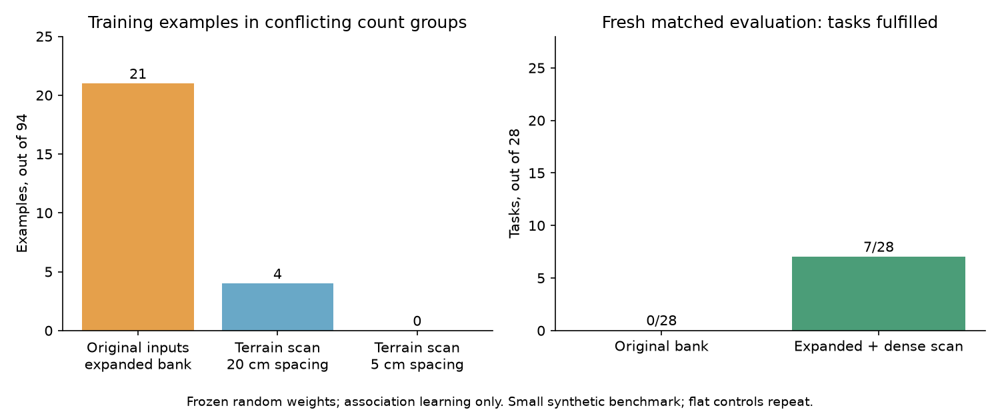

# Expanded skill-outcome learning

Later motor-controller update: the live `run_learned` demo now defaults to the
[smooth short-forward jump](smooth_forward_jump_validation.md). Add
`--jump-profile legacy` to reproduce the in-place-hop demonstrations in this
report. The model checkpoints, collected outcomes and historical comparison
commands retain their original primitive contract; this later update changes
the live motor profile, not the saved SNN or association bank.

October 16, 2026. Collected **204 new matched skill trials**, learned **94-example
association banks**, and ran **256 comparison/regression episodes**: 460 core
simulation episodes in this milestone. The new dense-terrain model fulfilled
**7/28 fresh tasks versus 0/28 for the original bank**. Old regression task
fulfillment remained **6/12**. All core episodes recorded zero collisions/falls;
guard stops and unsuccessful waits remain failures.



## What was learned

The original random SNN's 14 input columns and biases remain unchanged. A
separately versioned encoder appends eight frozen random terrain-input columns
using seed 4242, with standard deviation 1/sqrt(8). It retains 16 output neurons,
16 internal window steps, beta .9, threshold 1, and zero membrane reset per
observation. It does not train SNN weights. The learned artifact is a memory
mapping complete 16-neuron spike-count vectors to existing skills.

The bank contains 40 verified original training examples plus 54 new training
contexts: **27 run, 26 requested in-place jump, 41 local wait fallback** labels.
A wait label means none of the available task-matching candidates fulfilled
the task in that context. It is not a successful terrain crossing.

Added inputs describe terrain presence, relative surface rise, maximum sampled
up/down changes, mean forward/cross slope, roughness and friction loss. The
dense version samples 0-1.4 m ahead every 5 cm, at lateral offsets -0.2,0,0.2 m
in the current robot heading. These are privileged current simulator-map
observations, not camera perception or future outcome information. On flat
ground the extra inputs are zero, reproducing the original spike raster for
the same original inputs. The original encoder artifact remains separate.

## Data, labels and splits

The [initial protocol](expanded_association_protocol.md) fixed 96 contexts:
60 curriculum scenes with new seed 20261019, plus 36 varied-goal/heading flat,
requested-hop, static-blocker and moving-crossing contexts with seed 20261020.
There are 54 training, 14 validation and 28 held-out contexts. Matched wait,
run and jump were executed separately in all 68 training/validation contexts:
**204 attempts**, including **19 rejected/failed attempts**. These comprise
15 rejected starts and four clearance stops. No attempts were discarded.

For terrain, a completed primitive must additionally end with X>=1.55 m and
absolute Y<=.35 m to fulfill the task. Other forward tasks require >.10 m
heading-relative progress; that is a short skill test, not destination arrival.
Requested hop requires >=.04 s verified flight and stable landing. Only the
task-matching skill competes for a positive utility. Successful wait is the
zero-utility fallback. Existing eligibility, collision, posture, torque,
interruption, timeout and stable recovery guards remain active.

Terrain trials use eight-second primitives and an 18-second timeout; other
trials use four seconds and a 12-second timeout. Each starts with two seconds
of settling, selects once, executes without resetting physics, then recovers.
The three candidate trials share identical observed inputs before actuation.

Only training examples enter either bank. Original examples were reused only
after checking saved trial hashes and reproducing their count vectors from
their saved causal observations. Old validation/test examples were not added.
Validation and evaluation never update labels, thresholds, scales or weights.
Neighbors remain up to three unanimous examples within Euclidean distance 4,
including ties. Silent/unknown/conflicting patterns abstain; eligible wait is
the fallback, otherwise selection abstains completely.

## What the extra testing revealed

Merely adding examples with the old 14 inputs created **one conflicting count
vector shared by 21 training examples**: flat ground, thresholds, ramps, steps,
blocks, slopes and friction patches could have identical encoded observations,
yet require different skill labels based on their measured outcomes.

The first terrain encoder used 20 cm sample spacing. It reduced that conflict
to four examples: three flat controls labeled run and one threshold labeled
wait. The threshold was only 11 cm wide and fell between forward samples 0.6
and 0.8 m, so its terrain inputs were zero. The
[dense-scan follow-up protocol](dense_association_protocol.md) fixes this
training-set coverage defect with a 5 cm grid. The same recorded outcomes were
re-encoded, not relabeled. No new physical training trials or validation/test
labels were added. **The dense bank has zero conflicting training vectors**
and 85 unique count vectors among its 94 examples.

Validation label agreement, out of 14, was 8 for the original bank, 10 for the
expanded old-input bank, 11 for the coarse terrain bank, and **13 for the dense
bank**. Dense proposal coverage was also 13/14. Agreement includes legitimate
wait labels and must not be interpreted as task completion.

## Physical comparisons

The initial 28-context comparison was preserved, including the coarse scan's
failure. The original bank fulfilled 1/28 tasks; expanded old-input and coarse
terrain banks each fulfilled 5/28. Direct run fulfilled 8/28, but cannot fulfill
requested-hop tasks. Each learned update fulfilled the same 6/12 exposed old
regression tasks as the original. The initial comparison comprises 112 held-out
episodes plus 36 regression episodes.

For the dense follow-up, the model was frozen before a **separate fresh draw**:
terrain seed 20261023, flat seed 20261024, held-out variants only, with fresh
context identifiers. This avoids presenting the already inspected coarse
comparison as an untouched final evaluation. It comprises 84 fresh episodes
and 24 exposed old regression episodes.

| Fresh comparison, 28 cases per mode | Original bank | Expanded dense bank | Direct-run diagnostic |
| --- | ---: | ---: | ---: |
| Task fulfilled | 0 | 7 | 7 |
| Primitive completed | 28 | 27 | 19 |
| Pattern proposals | 2 | 22 | 28 fixed run requests |
| Fallback selections | 26 | 6 | 0 |
| Executed run / jump / wait | 0 / 0 / 28 | 7 / 2 / 19 | 28 / 0 / 0 |
| Collisions / falls | 0 / 0 | 0 / 0 | 0 / 0 |
| Maximum torque | 7.384 N m | 24 N m | 24 N m |

Dense task fulfillments were 2/20 terrain traversals (flat controls), 3/6 short
forward-progress tests, and 2/2 requested hops. It chose 19 waits, all unfulfilled
tasks. One moving-crossing run stopped at the clearance guard. Another run on
a harder ramp completed and recovered but failed to cross the course. The two
friction-patch controls were traversable by direct run but still produced waits
from the learned selector. Thus the bank remains conservative and incomplete.

The fresh direct-run control had six rejected starts and three clearance stops.
Its seven task fulfillments comprise four terrain traversals and three short
forward tests; it cannot satisfy the two hop requests. Equal totals therefore
do not mean equal task coverage or establish that either controller is superior.

On the twelve exposed old regression contexts, task fulfillment remained 6/12
for both original and dense models. Primitive completion changed from 12/12
to 11/12: the updated model tried running in `crossing_right_to_left-06` and
stopped at the clearance guard, whereas the original waited. Both failed that
task. The six previously fulfilled tasks were retained. The updated model meets
the protocol's limited task/contact/fall promotion criterion, but the extra
guard stop and small sample remain material limits. Use the explicit updated
entry point below; old version-specific commands retain their old contracts.

## Saved model and recorded execution

The portable bundle is `docs/agents/expanded_association_v2/`. It contains the
dense encoder, association memory, original comparison artifacts, re-encoded
labels, validation, fit manifest, evaluation rows/aggregate and independent
audit. The first expanded/coarse comparison is archived separately under
`docs/agents/expanded_association_v1/`.

Dense encoder checksum:
`de418f7e9ecfb78c1965558b39da2cfadf8a553bc73165794123a61d60fc2d2d`.
Association checksum:
`3968645384fc5a9aee6322a0f2fcda919236de65da38765749c78164d3d10709`.

The release demo loads this portable bundle and physically completes a learned
flat-course run (~1.72 m), gentle-ramp crossing (~1.69 m), and requested in-place
hop (0.120 s verified flight and stable landing). These are demonstrations on
known training contexts, separate from fresh evaluation. Their MP4 recordings,
neural decisions and trajectories are in
`output/spike_pattern_skills/learned-release-demo-v1/`.

From the project root:

```powershell
# Finite live demonstration of the saved updated model
.\.venv-win\Scripts\python.exe -m experiments.spike_pattern_skills.run_learned --viewer --jump-profile legacy

# Same learned model, recorded MP4 and JSONL telemetry without leaving a viewer running
.\.venv-win\Scripts\python.exe -m experiments.spike_pattern_skills.run_learned --video --jump-profile legacy

# Explicit fresh evaluation contexts
.\.venv-win\Scripts\python.exe -m experiments.spike_pattern_skills.run_learned --viewer --cases fresh-new-terrain-00-flat-04 fresh-new-requested_hop-07

# Reproduce collection, first comparison, dense fit and fresh comparison in new folders
.\.venv-win\Scripts\python.exe -m experiments.spike_pattern_skills.learn_expanded --output output/spike_pattern_skills/my-expanded-study
.\.venv-win\Scripts\python.exe -m experiments.spike_pattern_skills.refine_associations --source output/spike_pattern_skills/my-expanded-study --output output/spike_pattern_skills/my-dense-study
.\.venv-win\Scripts\python.exe -m experiments.spike_pattern_skills.run_learned --bundle output/spike_pattern_skills/my-dense-study --viewer
```

Collection reuses original training evidence under
`output/spike_pattern_skills/associations-v1/`. On a clean checkout, first run
`python -m experiments.spike_pattern_skills.learn_associations` to reproduce that
150-attempt original collection if those ignored raw files are absent. Saved
bundle inference does not require the old raw files. All training/evaluation
output folders refuse overwrite; choose fresh names. `run_learned` chooses a
unique output folder by default. Closing its viewer ends the finite demo.

Actual new raw data is in `output/spike_pattern_skills/expanded-associations-v1/`
and `output/spike_pattern_skills/dense-associations-v1/`. The former contains all
204 candidate CSV traces/JSON summaries, observations and both initial encoder
responses. The latter retains the dense transformation and separate evaluation.
Execution episodes flush inputs, rasters/counts/IDs, decisions, eligibility,
actual skill, pose/velocity, actuator commands, terrain contacts and final
outcomes. No model fitting occurs during live execution.

## Verification and limits

An independent replay checked all **204 candidate traces** and **256 evaluation
episodes**. It verified recorded pattern arithmetic and decisions, recomputed
task fulfillment from terminal CSV states, checked training-only example IDs,
and verified that model artifacts stayed unchanged through evaluation. See
[audit.json](expanded_association_v2/audit.json). All 460 core episodes recorded
zero collisions/falls and torque no greater than 24 N m.

Model-loading guards were tightened after fitting to refuse coarse/dense
observation-schema mixtures. The manifests retain collection-time source
fingerprints; the audit explicitly records those two validation-only source
revisions. Replay confirms that encoding arithmetic and saved patterns did
not change. Encoder and association checkpoints were not modified.

The final release suite passed **126 tests in 133.121 seconds**, including the
saved-bundle training-split/alias-resolution test. Its complete log is saved in
`output/spike_pattern_skills/expanded-release-suite.log`. Tests cover preserved
old weights/responses, deterministic splits, terrain discrimination, local
sampling, missed narrow thresholds, schema refusal, saved-bank provenance,
conflict abstention, task scoring and actual logged physical execution.

These remain small synthetic families, with repeated flat control conditions
and closely related seed variants. A separate draw is not a new environment
distribution. The first 28 cases became development evidence for the later
comparison. The twelve regression contexts were previously exposed and are
not an independent test. No claim of statistical superiority is supported.

The hop still requires an explicit task input and is in-place; there is no
learned forward obstacle-clearing jump. Better motor skills are required for
thresholds, steps and slopes, and box-aware geometry is needed for the rejected
passages. Unknown patterns, the friction-patch misses and moving-hazard guard
stops identify further collection targets. Camera perception, repeated decisions,
and low-level policy training remain separate milestones. These simulation
results do not certify physical robot operation.
