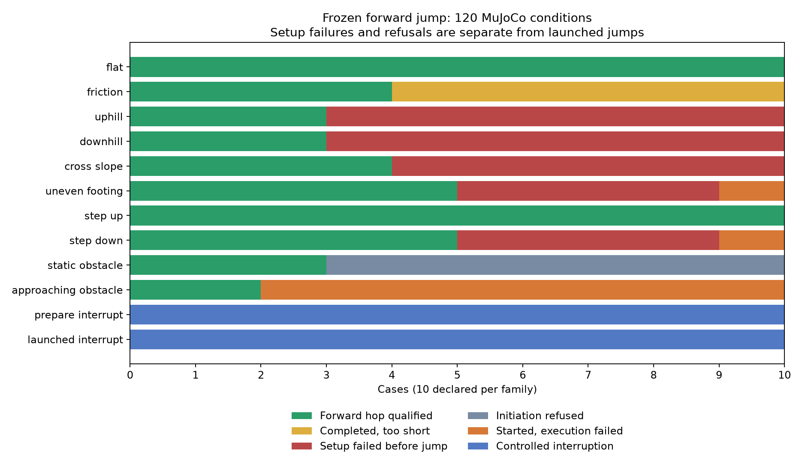

# Forward jump under 120 test conditions

Measured October 16, 2026 in articulated MuJoCo simulation. The saved forward
jump profile was frozen before this batch: 28 N m actuator limit, unchanged
quintic trajectory and landing gains. No controller tuning, SNN training,
association fitting, external pushes or injected motion took place.

## Result

The short forward hop works reliably in these flat scenes and mild terrain.
It is not yet a general terrain-jumping skill. Across **100 ordinary hop
conditions**, 49 qualified, six completed with too little forward travel,
28 failed during standing/setup, seven were refused, and ten failed after
starting. Of the **65 ordinary cases actually initiated**, 49 qualified and
55 completed. All **20 interruption cases** recovered stably. These are fixed
diagnostic conditions, not independent population samples or a success-rate
estimate for arbitrary environments.

Qualification requires completion, stable landing, no collision/fall, continuous
flight >=.06 s, total forward travel >=.10 m, and positive airborne forward
travel. Completion alone requires >=.04 s flight. A successful interruption
reports interrupted and stable recovery, rather than a completed hop.



| Conditions (10 each) | Forward qualified | Completed, too short | Setup failed | Refused | Started, failed | Controlled interruption |
|---|---:|---:|---:|---:|---:|---:|
| Flat, varied heading and start | 10 | 0 | 0 | 0 | 0 | 0 |
| Friction .10–1.4 | 4 | 6 | 0 | 0 | 0 | 0 |
| Uphill 1–15 degrees | 3 | 0 | 7 | 0 | 0 | 0 |
| Downhill 1–15 degrees | 3 | 0 | 7 | 0 | 0 | 0 |
| Cross-slope 1–15 degrees | 4 | 0 | 6 | 0 | 0 | 0 |
| Uneven front-foot support 5–50 mm | 5 | 0 | 4 | 0 | 1 | 0 |
| Step ahead, up 5–50 mm | 10 | 0 | 0 | 0 | 0 | 0 |
| Initial platform/step down 5–50 mm | 5 | 0 | 4 | 0 | 1 | 0 |
| Static blocker .8–1.7 m ahead | 3 | 0 | 0 | 7 | 0 | 0 |
| Approaching blocker .05–.50 m/s | 2 | 0 | 0 | 0 | 8 | 0 |
| Preparation interruptions 0–.50 s | 0 | 0 | 0 | 0 | 0 | 10 |
| Interruptions .56–1.50 s after start | 0 | 0 | 0 | 0 | 0 | 10 |

All 28 recorded contact events were **before jump initiation**, involving the
terrain contact guard during setup. No initiated episode recorded a collision
or fall. There were no falls in the whole batch. This distinction matters:
setup failures assess scene placement/standing as well as terrain compatibility,
and do not establish failure of an airborne maneuver on those slopes.

## What the conditions exposed

* **Flat ground:** all ten passed, with 17.5–18.4 cm total forward travel
  (mean 17.8 cm). These are new deterministic heading/start variations, not
  re-labelled historical validation episodes.
* **Friction:** all ten completed and landed, but coefficients .10–.40 gave
  only .9–8.8 cm total travel. The tested .55–1.4 cases qualified, travelling
  13.8–21.8 cm. This brackets a failure region in this sweep; it does not
  establish an exact universal friction threshold. Foot normal landing force
  peaked at 470 N in the .40 case. Landing impact still needs work.
* **Slopes:** the 1–3 degree uphill/downhill cases passed. Cross-slope 1–4
  degree cases passed. Higher angles stopped during initial standing, before
  the two-second decision. The body is spawned at the existing fixed home
  height; terrain changes its posture through contacts. Larger ramps and
  raised supports can make this initialization unsuitable. Terrain-aware
  initial placement and stable standing need separate development before
  claiming a jump-angle limit.
* **Uneven support:** 5–25 mm front-foot blocks passed. At 30 mm the episode
  started but retained at least three foot contacts in every recorded frame,
  giving no verified flight. At 35–50 mm setup hit the contact guard. The
  30 mm platform/step-down case similarly kept four foot contacts throughout;
  larger platforms failed during setup. These are real lost-flight outcomes,
  not merely a threshold rejecting a brief airborne interval.
* **Steps ahead:** all ten hop criteria passed, but the base did not pass the
  .30/.40 m step edge. Some front-foot contacts may reach a step while the
  rear remains behind. **Whole-robot step clearance was not established.**
  The plane remains under all patches; no gaps were tested.
* **Static obstacles:** blockers .8–1.4 m ahead were refused by the projected
  corridor check; 1.5–1.7 m cases completed. These are clearance checks, not
  attempts to jump over the blocker.
* **Moving obstacles:** .05 and .10 m/s approaching blockers completed. The
  .15–.50 m/s cases hit the clearance stop while executing/recovering. The
  current initiation check uses current positions; it does not reserve a
  collision-free corridor over the full hop and recovery. These guard stops
  avoided recorded collision but did not complete the task; no continuation
  after the stop was simulated.
* **Interruptions:** all preparation requests completed the smooth return
  without verified flight. All post-thrust requests finished landing and
  recovered, reporting interrupted. This tests the existing interruption
  contract, not a new reflex controller.

The next work should address terrain-aware setup, contact-aware takeoff when
supports differ, prediction of moving-obstacle occupancy through recovery, and
landing-force reduction. Increasing torque alone does not resolve these findings.

## Evidence, checks and reproduction

The [protocol](jump_stress_protocol.md) was written before execution. Exact
120 scenes, frozen configuration, source hashes, full results and audit are in
[jump_stress_v1](jump_stress_v1/manifest.json). Every trial also retains its
500 Hz `trace.npz` and `result.json` under
`output/smooth_jump/stress-v1/<case>/`. The compact archive keeps the raw outcome
labels; `audit.json` explicitly splits their broad `execution_failure` category
into pre-initiation setup failures and initiated failures. Displacement before
initiation is settling drift and is excluded from jump-travel comparisons.

The independent audit checked all 120 finite traces, exact frozen source/config
hashes, terminal times and torque limits. For all 85 initiated cases it
recomputed heading-relative travel, peak base acceleration, torque-step RMS
and longest continuous flight directly from the physics samples. Eight existing
jump-specific tests passed in 4.408 s, covering trajectory continuity, measured
motion, actual actuator limits, corridor refusal, interruptions, error cleanup
and learned-selector fallback. The first sandboxed test run hit temporary-folder
permissions in two tests; rerunning with TEMP/TMP inside project `tmp/` passed.
The controller was unchanged, so the full project suite was not rerun here.

```powershell
.\.venv-win\Scripts\python.exe -m experiments.jump_stress --output output/smooth_jump/stress-v2
.\.venv-win\Scripts\python.exe -m experiments.audit_jump_stress --input output/smooth_jump/stress-v2
.\.venv-win\Scripts\python.exe -m experiments.jump_stress --output output/smooth_jump/example-replay --replay uneven_footing-05 --video
```

Four finite video replays, including failures, are saved under
`output/smooth_jump/stress-replays-v1/<case>/<case>/recording.mp4`:
`flat-00`, `uneven_footing-05`, `approaching_obstacle-09`, and `uphill-03`.
All four MP4s were decoded and their replay physics traces matched the original
traces exactly; see `jump_stress_v1/replay_checks.json`.
This is simulation evidence only; no hardware was used.
