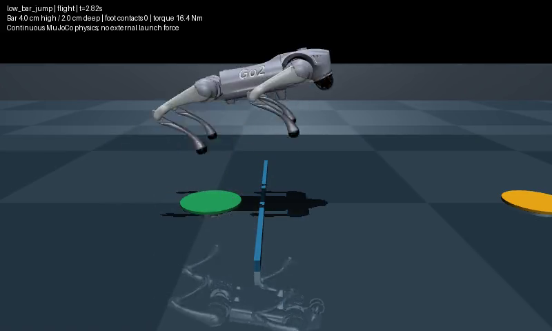
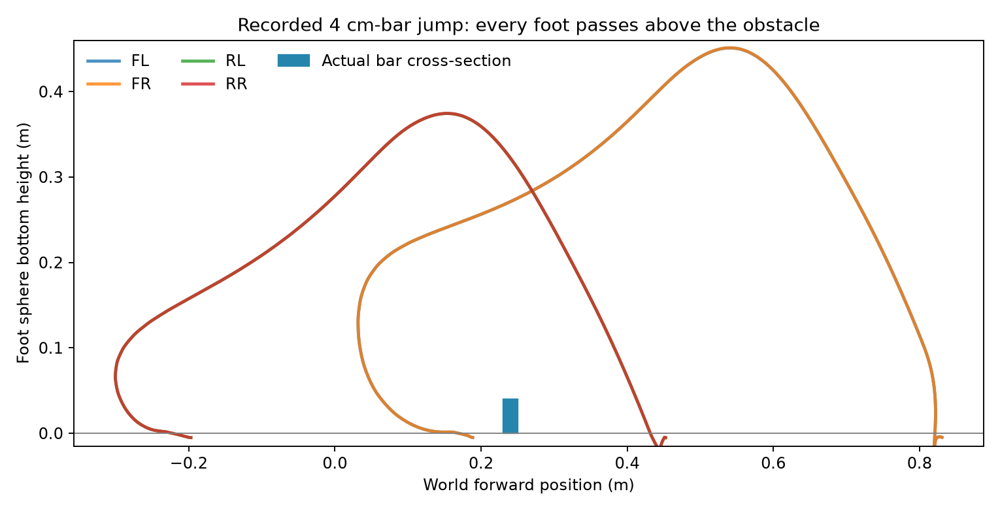

# A real low-obstacle jump

Measured October 16, 2026. The new experimental skill clears a **4 cm-high,
2 cm-deep, 1.2 m-wide bar**, 24 cm ahead of the initial base position, in a
single standing jump. It lands stably on the far side with no bar contact.
All four foot spheres and every robot collision primitive finish beyond the
far face. No walk-up, exit walk, external lift, velocity injection or state
reset is used during the maneuver.

The recorded nominal episode travelled **64.7 cm** from the settled starting
position, had **.482 s** continuous all-feet flight, and settled with four
supported feet for .8 s. The smallest foot-bottom clearance while overlapping
the bar was **22.2 cm**. The rearmost collision primitive finished **1.21 cm**
beyond the far face. The latter is a small horizontal margin, despite the large
foot clearance in flight; nearby landing contacts remain a real failure mode.



Full-speed recording: `output/obstacle_jump/release-demo-v2/recording.mp4`.
Half-speed excerpt of source t=1.8–4.0 s:
`output/obstacle_jump/release-demo-v2/slow-motion.mp4`.

## What changed

`skills/obstacle_jump.py` adds an explicit low-bar crossing executor and the
restricted callable `execute_low_bar_jump()`. The implementation reuses the
quintic trajectory and joint PID, with a separately saved profile: deeper
flight tuck, stronger forward extension, different thrust/landing timing and
gains, and a **72 N m simulation actuator bound**. PID limits and actual MuJoCo
control/force bounds agree. The existing 28 N m short-hop defaults are unchanged.

The target must be an explicitly named static aligned box. Only that target
is exempt from the ordinary 2D clearance calculation: its physical contacts
still abort on **any** robot geom, including feet. Other obstacles and walls
retain their clearance/contact checks. Finite-state, minimum height, 35-degree
tilt, timeout, interruption and torque-cleanup checks remain active. Stopping a
simulation at a guard is a reported failure, not demonstrated recovery afterward.

The executor records every 2 ms physics sample: all joint/base state, motor
torques, foot sphere centers, support count, posture, and rearmost collision
projection. Crossing requires every foot's complete sphere footprint to pass
above the bar, every foot and collision primitive to finish beyond it, a shared
flight interval >=.04 s, no contact/fall, staying within the bar's lateral span,
and stable recovery. A jump beside the bar or one leaving rear feet behind fails.
The model's original contact softness permits some foot-floor penetration;
clearance over the bar uses the sphere bottom, not a foot-site point.

`standalone/low_bar_jump` is listed in `skills.registry` as **experimental and
callable**, with known failure rates. It has no SNN class and is not eligible
for SNN selection. `run_skill('standalone/low_bar_jump')` invokes it. This runner
owns a complete standalone episode; handoff into the persistent hybrid navigation
loop has not been implemented. No SNN weights, spike associations or historical
datasets were retrained or relabelled.

## Frozen evaluation and failures

The selected candidate was frozen before these tests. The broad heading split
exposed failures, after which the public callable was restricted to the +world-X
direction and assessed in a fresh split. The motor profile stayed unchanged.
These are deterministic scene variations, not population reliability estimates.

| Split | Cases | Full crossings | Contact stops | Other failures |
|---|---:|---:|---:|---|
| Fresh headings, starts, bar dimensions and friction; seed 20261029 | 24 | 19 | 3 | 2 stable landings without full rear clearance |
| Declared boundary combinations | 4 | 4 | 0 | 0 |
| Fresh +X starts/dimensions/friction; seed 20261030 | 16 | 14 | 2 | 0 |
| Further bars / friction outside the assessed range | 6 | 0 | 3 | 2 incomplete crossings, 1 posture/height stop |
| Preparation and post-thrust interruption | 2 | 0 completed hops | 0 | Both reported interrupted and recovered stably |

The +X entry accepts only aligned low bars 23–24 cm from the start, 2–4 cm
high, 1.2–2 cm deep, at least 1.2 m wide, friction .8–.9, start within .3 m of
the world origin, and no terrain patches or scheduled pushes. **These entry
conditions do not guarantee success:** the fresh +X split still had two rear
thigh contacts during landing. Broad heading cases had three similar contacts.
Do not infer reliability between or beyond the tested points. A user can run
explicit-config development diagnostics outside the public entry's restriction.

A recorded failure replay is retained at
`output/obstacle_jump/failure-replay-v1/recording.mp4`: case `axis-05` has a bar
approximately 3.88 cm high and catches the rear thighs during landing despite
all four feet having passed above it. This demonstrates why airtime or foot
clearance alone is insufficient. The farther/slipperier stress cases also remain
failures. Further work should reduce rear-leg landing sweep, increase horizontal
margin and reduce landing impact, then re-evaluate on untouched scenes.

Development retained **96 flat parameter trials and 289 bar trials**: 36 initial
bar attempts, 240 randomized attempts at a farther bar, and 13 height/distance
probes. Only one of those 289 bar-development trials met the complete crossing
criterion. Their contact, posture and incomplete-crossing failures remain in the
archive. The random candidate search seed was 20261028; selected candidate 065
from `bar-development-v2` supplied the profile. The final closer takeoff distance
was chosen on the development probes, not the fresh splits. Early diagnostic
videos and repeated test episodes are not counted as independent conditions.

## Verification and reproduction

**141 project tests passed in 70.215 s.** Seven focused jump tests also passed
in 4.161 s, covering actual full crossing, force/control agreement, absence of
external applied forces, whole-foot clearance, contact failures, other-obstacle
refusal, restricted entry, interruptions, callback cleanup, immediate viewer
closure, and unchanged SNN classes. The first sandboxed full-suite run hit
loopback socket restrictions in two existing HTTP tests; the final run with
loopback access passed. Logs are in `output/obstacle_jump/` and the compact archive.

The independent trace audit checked all **53** frozen-evaluation/demo traces:
finite state, exact frozen configuration, applied torque bounds, continuous
flight and per-foot bar clearance. It checked terminal support/speed and full
crossing fields for successes. For every nominal demo frame it additionally
reconstructed qpos/qvel in the actual MuJoCo model and checked that the bar had
no contacts. The video is rendered from that same physical episode.



```powershell
# Finite viewer and recording; close the viewer to end early.
.\.venv-win\Scripts\python.exe -m experiments.obstacle_jump --output output/obstacle_jump/my-demo --viewer --video

# Headless recorded demonstration.
.\.venv-win\Scripts\python.exe -m experiments.obstacle_jump --output output/obstacle_jump/my-video --video

# Freshly reproduce the fixed assessment splits into new directories.
.\.venv-win\Scripts\python.exe -m experiments.obstacle_jump --phase evaluate --output output/obstacle_jump/recheck-wide
.\.venv-win\Scripts\python.exe -m experiments.obstacle_jump --phase evaluate --axis --output output/obstacle_jump/recheck-axis

# Focused tests.
.\.venv-win\Scripts\python.exe -m unittest discover -s tests -p test_obstacle_jump.py -v
```

Each output directory is exclusive, preserving earlier evidence. The compact
[artifact manifest](obstacle_jump/manifest.json) indexes configuration, all
development/evaluation result rows, exact scenarios, source/artifact hashes,
checks and nominal outcome. Raw traces remain under `output/obstacle_jump/`.
The [protocol](obstacle_jump_protocol.md) defines the milestone. This is a
simulation prototype; 72 N m is a tested simulation setting, not an established
physical Go2 motor rating. No physical robot was used.
