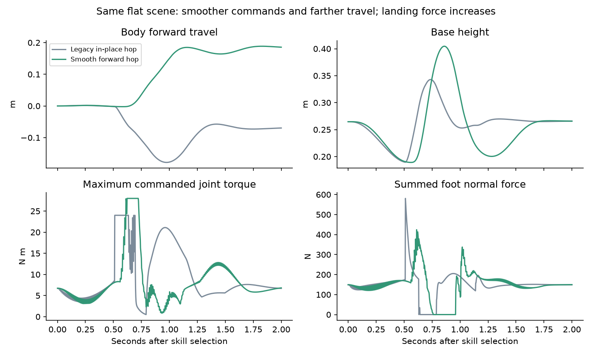

# Smoother short-forward jumping

October 16, 2026. The user requested smoother jumping, a little more forward
distance, and removal of the prior torque restriction. The new simulation
profile moves the base **16-20 cm forward** in 16 fresh flat-ground conditions,
including about **8 cm while all feet are airborne**, with stable recovery in
all 16. Peak base acceleration and torque-step RMS are substantially lower.
Peak landing force is higher than the old, smaller hop and remains a tradeoff.



## Controller change

The old hop jumped between crouch and extension targets, producing a maximum
100 Hz target step of 1.30 rad and desired velocity of about 130 rad/s before
the 24 N m torque clamp. Its nominal flat-scene outcome drifted backward.

`skills/jump_profile.py` supplies a preparation, thrust, flight/retraction,
absorption and recovery sequence. Each joint-target segment is a quintic with
zero first and second derivatives at endpoints, so the analytic trajectory is
continuous in position, velocity and acceleration. The trajectory is sampled at
100 Hz; joint PID still runs at 500 Hz. Analytic desired velocity replaces the
jump's finite-difference velocity spikes. Landing gains blend continuously down
during flight and back to normal during recovery. The backward foot-target
offset during extension generates forward momentum; there is no walking run-up,
external push, qpos correction or velocity injection.

The user-authorized torque revision updates the actual MuJoCo control range,
force range and PID bound together when the forward jump starts. The old 24 N m
cap was not a tuning restriction. Bounds of 28,32,36,40,48 N m were tested in
the recorded development sweeps. The chosen profile uses **28 N m**, because
higher settings were not consistently smoother or more stable. Configurable
bounds remain explicit, positive and finite. A test verifies actual simulated
actuator force equals the torque command, including commands above 24 N m.

The selected timings are .55 s prepare, .22 s thrust, .16 s retraction, .20 s
absorption and .60 s recovery. All poses remain inside the model's joint
ranges. Landing gains blend toward Kp=35 and Kd=1.5, then return to the normal
values. The full frozen configuration is in
[config.json](smooth_forward_jump/config.json).

Existing posture, collision, finite-state and clearance guards remain active.
The forward profile additionally requires a clear projected 0.5 m corridor,
with the existing 0.35 m jump clearance margin. It can therefore reject an
obstacle configuration that was eligible for a stationary hop. The supervisor
can choose eligible wait instead. This current-state check is not a moving
obstacle avoidance planner.

Before-thrust interruption finishes the preparation segment, returns smoothly
without launching, and reports interrupted. Once thrust starts, the trajectory
finishes its landing sequence before reporting interrupted. Timeouts and viewer
closure still terminate the simulation as failures; exceptions release torque.

## Development and frozen evaluation

The [protocol](smooth_forward_jump_protocol.md) fixed the objectives and metric
distinctions. Three sequential development sweeps recorded **217 candidates**:
100 thrust/lean/bound trials, 81 lower-arc pose trials, and 36 landing-gain and
absorption trials. All failed candidates remain in the data. There were 52
primitive-completion failures and 122 candidates satisfying the additional
forward-flight criterion. Some candidates completed but had inadequate forward
distance or flight. Higher-force configurations sometimes triggered the posture
guard; they were not counted as improvements.

The earliest sweeps used discrete gain transitions; the landing sweep replaced
these with continuous blends. Earlier controller sources are retained under
`output/smooth_jump/pre-gain-blend-source/`. The final configuration was selected
from development only, then frozen before validation. No settings were changed
to fix validation or stress outcomes.

The fresh paired validation used seed **20261025**, 16 random headings, starts
and friction coefficients in [.65,1.05]. Legacy and forward profiles ran in
separate matched episodes. All 32 episodes completed and recovered without
collision or fall. The forward-distance criterion requires >=.10 m total
heading-relative travel, >=.06 s verified flight, positive airborne travel,
and stable recovery. Only the new profile satisfies this criterion.

| Fresh validation metric | Legacy hop | Smooth forward hop |
| --- | ---: | ---: |
| Stable primitive completions | 16/16 | 16/16 |
| Forward-hop criterion fulfilled | 0/16 | 16/16 |
| Mean total forward base travel | -6.72 cm | +18.18 cm |
| New total travel range | — | 15.80-19.86 cm |
| Mean forward travel while airborne | -4.82 cm | +7.80 cm |
| Mean peak base acceleration | 42.92 m/s² | 19.44 m/s² |
| Mean torque-step RMS, at 500 Hz | 1.304 N m | .369 N m |
| Maximum tilt | 20.54° | 8.44° |
| Mean peak landing normal force | 205 N | 347 N |
| Maximum applied joint torque | 24 N m | 28 N m |
| Collisions / falls | 0 / 0 | 0 / 0 |

This is approximately **55% less peak base acceleration** and **72% less
torque-step RMS**, with markedly smaller command discontinuities. It is not a
claim that every landing metric improves: peak landing normal force increased
about 69%, and touchdown downward speed increased. Greater forward/vertical
flight carries more landing energy. The selected configuration sacrifices some
force reduction to retain posture-height margin; deeper absorption reduced
force but sometimes triggered the height guard during development.

Distances are the world base position projected onto the heading at selection.
The airborne value uses the longest all-feet-airborne interval. Total travel
includes takeoff and landing motion; **18 cm is not an 18 cm gap-clearing claim**.
These distances are not a measurement of whole-robot centre-of-mass travel.

## Stress, refusals and integration

Six additional paired stress conditions covered friction .35,.5,1.1,1.2 and
uniform 1 cm/2 cm support platforms. All 12 episodes completed and recovered
without collision or fall. The new profile fulfilled the >=10 cm forward-hop
criterion in **5/6**. At friction .35 it travelled only 7.06 cm, so that task
remains a failure despite stable landing. This outcome was retained, not tuned
away. These are flat or uniform-support tests, not stairs, gaps or obstacle jumps.

Six requested-hop cases from the saved learned-selector dataset also selected
the new jump, completed and landed stably with different headings/friction.
Their records are in
[learned_integration.json](smooth_forward_jump/learned_integration.json).
A separate complete learned-model video run retained successful flat run and
ramp crossing and used the smooth forward hop for the jump request.

The latest `run_learned` demo defaults to `smooth_forward`. The standalone
dynamic API and historical collection/evaluation wrappers retain their legacy
default so archived in-place-hop experiments remain reproducible. Select the
new profile explicitly with
`execute_dynamic_skill('jump', jump_profile='smooth_forward')`.
The SNN weights and association bank did not change in this milestone; a jump
proposal dispatches a different, explicitly recorded motor profile. No new SNN
output class or claim of obstacle-clearance competence was introduced.

## Run and review

From the project root, using the existing Windows environment:

```powershell
# One finite smooth-forward jump, with a viewer and recorded video
.\.venv-win\Scripts\python.exe -m experiments.smooth_jump --viewer --video

# Updated learned selector demo, with the new jump profile
.\.venv-win\Scripts\python.exe -m experiments.spike_pattern_skills.run_learned --viewer

# Reproduce the old hop for comparison
.\.venv-win\Scripts\python.exe -m experiments.smooth_jump --profile legacy --viewer
.\.venv-win\Scripts\python.exe -m experiments.spike_pattern_skills.run_learned --viewer --jump-profile legacy

# Reproduce the frozen paired validation in a fresh output directory
.\.venv-win\Scripts\python.exe -m experiments.smooth_jump --phase evaluate --config docs/agents/smooth_forward_jump/config.json --output output/smooth_jump/my-validation

.\.venv-win\Scripts\python.exe -m unittest discover -s tests -v
```

Demo commands choose unique output directories unless one is supplied, and
refuse to overwrite an existing episode folder. They finish automatically;
closing the viewer stops early. They do not train a model in the background.

The recorded normal-speed jump is
`output/smooth_jump/release-demo-v2/recording.mp4`. The side-by-side clip is
`output/smooth_jump/comparison-slow.mp4`: legacy left, new right, played at
half speed from actual simulation frames, with no interpolated motion.
The complete updated learned-model recording is under
`output/smooth_jump/learned-release-demo-v1/`.

Raw development data is in `output/smooth_jump/development-v1/`,
`low_arc-development-v1/` and `landing-development-v1/`. Paired validation is
under `output/smooth_jump/validation-v1/`. Each trial retains its configuration,
scenario, summary and a compressed 500 Hz physics trace: base position/velocity/
acceleration, posture, contacts, normal force, airborne flag and motor commands.
Compact candidate rows, validation scenarios/results, aggregate, selected demo,
configuration and hashes are saved in `docs/agents/smooth_forward_jump/`.

## Checks and remaining limits

All **134 project tests passed** in 65.356 s; log:
`output/smooth_jump/full-suite.log`. Eight jump-specific tests also passed after
the final camera/force-observation checks. They cover analytic C2 boundaries,
joint ranges, actual forward flight and measured smoothness, model/PID torque
agreement, forward-corridor refusal, prepare/airborne interruption, observer
error cleanup, invalid configuration, unchanged wait bounds and learned-proposal
fallback. The final standalone and learned-demo MP4 runs completed successfully.

An independent audit recomputed travel, acceleration and torque-step metrics
from all **44 validation traces**, checked the frozen configuration and applied
bounds, and confirmed stable recovery/collision/fall fields. The source and
artifact hashes are in [manifest.json](smooth_forward_jump/manifest.json).

The profile is open-loop joint motion with scheduled gain blending, not a
contact-aware optimiser. Landing-force reduction remains unfinished. Very
slippery ground reduces distance; uneven landings, obstacle/gap clearance,
push disturbances and hardware transfer have not been established. Torque
bounds above the imported model's old 24 N m setting are simulation parameters,
not validated physical motor ratings. Keep simulation results separate from
physical Go2 capability.
