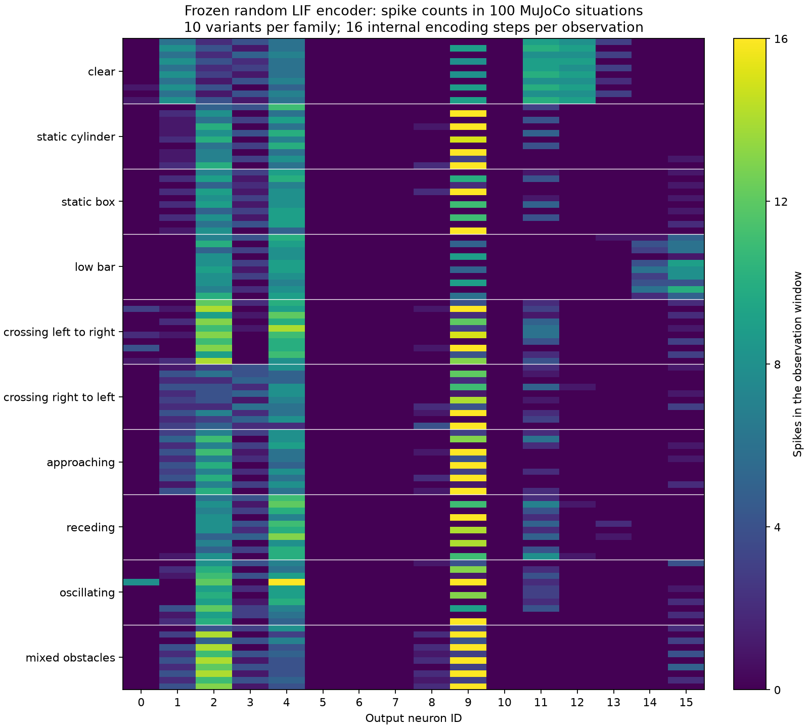

# Frozen SNN response in 100 different situations

Measured October 16, 2026. **All 100 situations produced complete spike records.**
The same frozen random encoder produced 40 distinct active-neuron ID lists,
99 distinct count vectors and 100 distinct full timing rasters. Counts therefore
retain much more information than an active-ID list in this particular sample.
This is an observation-encoding study, not a skill-selection accuracy result.

## What ran

The protocol was specified before observing these outputs: **10 scene families
with 10 variants each**, using study seed 20261016. The families are:

1. Clear space.
2. Static cylindrical obstacle.
3. Static box.
4. Low, wide bar.
5. Crossing obstacle, left to right.
6. Crossing obstacle, right to left.
7. Approaching obstacle.
8. Receding obstacle.
9. Oscillating obstacle.
10. Multiple mixed obstacles.

Variants change geometry, motion, initial heading/position, goal and friction
within the published generator's ranges. Friction is sampled from .65–1.05,
heading from -pi to pi, and goal distance from 2.2–3.1 m in the initial heading
frame. Fifty cases include an explicit in-place jump request, evenly distributed
across families. That request is a supplied input, not an inferred obstacle label.
All 100 scene configurations and all 100 observed feature vectors are distinct.
These are variants of ten designed scene families, not 100 independent buildings.

Each actual MuJoCo simulation stands the robot for two seconds and records one
current observation. Capture deliberately abstains before a movement skill runs.
There were **zero failed captures, zero obstacle contacts and zero falls**;
maximum standing torque was **7.3993 Nm**, below the existing 24 Nm ceiling.
No random output actuates the robot, and no skill labels were assigned.

The encoder is unchanged from the initial six-scene experiment: seed 42,
14 inputs, 16 LIF output neurons, 16 constant-current steps, beta .9, threshold 1,
and zero membrane state at each observation. Its weights and biases were loaded
from the saved checkpoint, rather than retuned for these situations.

Content checksum:
`b72b9750bffd70ee37bd0aaedb5064b58157d8f5a13f58b5cd356ca281fa70ec`.

## Results

| Representation | Distinct patterns among 100 observations | Pairs sharing an identical pattern | Cross-family shared pairs |
|---|---:|---:|---:|
| Active-neuron IDs | 40 | 147 | 95 |
| Full 16-neuron spike-count vector | 99 | 1 | 0 |
| Full 16-step x 16-neuron binary raster | 100 | 0 | 0 |

A shared pair is two observations producing exactly the same representation.
There are 4,950 possible pairs among 100 observations. These are descriptive,
dependent comparisons, not independent success/failure trials.

Counts distinguish **146 of the 147 pairs** sharing active IDs. For example,
`clear-01` and `crossing_right_to_left-03` both activate
`[1, 2, 3, 4, 9, 11, 12]`, but neuron 1 fires eight versus four times, neuron 11
ten versus five, and neuron 12 nine versus once.

The remaining count collision is `mixed_obstacles-05` versus
`mixed_obstacles-07`. Both produce:

```text
Neuron IDs:   0  1  2  3  4  5  6  7  8  9 10 11 12 13 14 15
Spike counts: 0  4 14  1  4  0  0  0  2 16  0  0  0  0  0  0
```

Their spike timing differs at six neuron/time cells, including neurons 1 and 2
around internal steps 10–11 (zero-based). Retaining the raster distinguishes
these observations even though counts alone do not. This timing is generated
inside a constant-input encoding window; it is not motion tracked across sensor
frames or evidence of learned sequence memory.

The network emitted **3,203 spikes**, averaging **32.03 per observation**. No
observation was entirely silent. Neurons **5, 6, 7 and 10 never fired** in this
sample; neurons **2 and 4 fired in all 100 situations**, with varying counts.
Some neurons reached 16 spikes, the one-per-step ceiling. Random initialization
has therefore not automatically produced an evenly used or task-optimized code.



## What the findings support

Keep both **active IDs and spike counts**, and retain the full raster for later
decoder comparisons. An ID-only lookup would merge many distinct observations.
Counts resolve almost all of those merges in this sample, while timing resolves
the remaining pair.

Distinct observations do not necessarily require distinct skills, and different
patterns do not establish correct behavior. A pattern mapping must still learn
which successful skill outcomes belong together, handle unknown observations
and preserve conflicting labels. There is no trained decoder or measured skill
accuracy here. One hundred distinct rasters do not establish generalization.

Robot/obstacle inputs remain privileged MuJoCo state. Only the nearest obstacle
supplies its detailed features; other obstacles mainly affect clearance. Clear
scenes still vary goal, robot state and task request, which can change spikes.
Several inputs vary together, so family differences cannot be causally attributed
to obstacle type alone. Wider scenes, repeated/noisy observations, controlled
ablations and outcome labels remain future work. No hardware was used.

## Published data and verification

The [complete compact archive](spike_pattern_100/manifest.json) is included in
Git, not just kept in the ignored local output folder:

- [`situations.csv`](spike_pattern_100/situations.csv): 100 rows containing raw
  features, active IDs and **one count column for every output neuron**.
- [`records.jsonl.gz`](spike_pattern_100/records.jsonl.gz): all 100 complete
  records, including raw observations, metadata, rasters and membrane traces.
- [`scenarios.json`](spike_pattern_100/scenarios.json): all 100 scene definitions,
  seeds and explicit task requests.
- [`model.npz`](spike_pattern_100/model.npz): the actual frozen weights, biases,
  normalization and model metadata, loadable without pickle.
- [`analysis.json`](spike_pattern_100/analysis.json): every collision group,
  per-neuron statistics and family summaries.
- [`counts_heatmap.png`](spike_pattern_100/counts_heatmap.png): count overview.
- [`manifest.json`](spike_pattern_100/manifest.json): archive checksums, source
  fingerprints, versions and capture/replay totals.

An independent audit verified all archive hashes, **100 exact model replays**,
the CSV counts and the reported collision totals. A separate scalar LIF
calculation checked **all 25,600 neuron/time-step cells**, including membrane
values and resets. The heatmap was visually inspected.

**All 12 focused experiment tests passed in .390 s**, including protocol
uniqueness, independent collision counting, silent-pattern retention and the
complete published-archive audit. Log:
`output/spike_pattern_skills/study-100-tests.log`. No training or navigation
evaluation batches were rerun for this observation-only milestone.

The capture command actually executed was:

```powershell
.\.venv-win\Scripts\python.exe -m experiments.spike_pattern_skills.study --model output/spike_pattern_skills/final-v1/model.npz --output output/spike_pattern_skills/study-100 --publish-to docs/agents/spike_pattern_100
```

To reproduce from a fresh checkout, use the committed checkpoint and an unused
output directory (existing recordings are preserved):

```powershell
.\.venv-win\Scripts\python.exe -m experiments.spike_pattern_skills.study --model docs/agents/spike_pattern_100/model.npz --output output/spike_pattern_skills/study-100-rerun
.\.venv-win\Scripts\python.exe -m experiments.spike_pattern_skills.audit
.\.venv-win\Scripts\python.exe -m unittest discover -s tests -p 'test_spike_pattern*.py' -v
```

Exact replay is verified in the recorded environment: Python 3.14.7, NumPy 2.5.3,
MuJoCo 3.13.0. This is not a promise of bitwise simulation equality under changed
software/platforms. No encoder parameters were changed after viewing results.
