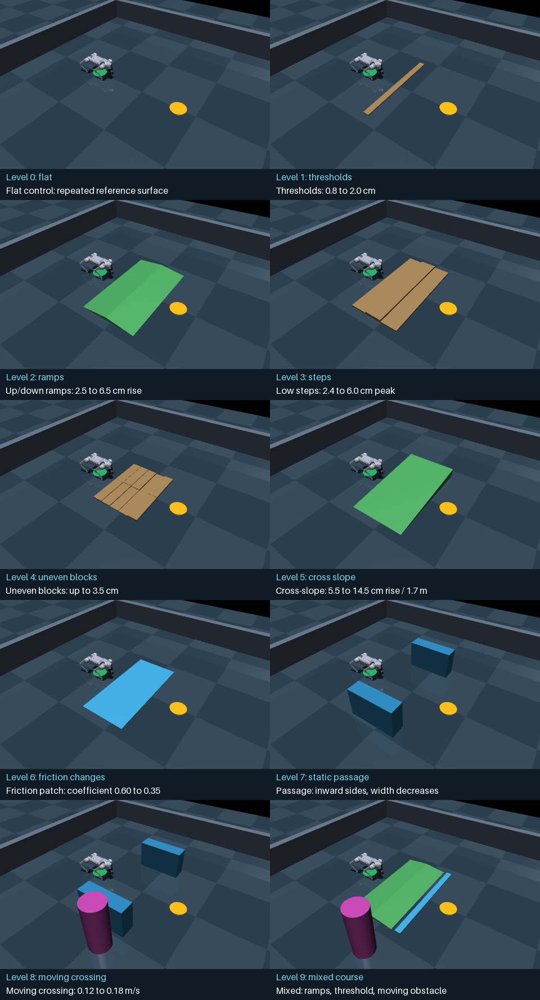

# Gradual terrain curriculum: implementation and results

October 16, 2026. Added ten ordered environment levels with six variants per
level, actual collidable terrain, live recording, a frozen-controller benchmark,
and optional enforced progression. The [protocol](terrain_curriculum_protocol.md)
defines ownership, interfaces, splits, guards and acceptance criteria.



## Environments and measured baseline

All 60 scenarios compile. The following table counts actual course crossings
by the existing direct-run primitive in six variants per level. It does not
claim learned SNN navigation on those surfaces.

| Level | Environment and increasing difficulty | Direct-run crossings |
| --- | --- | ---: |
| 0 | Flat reference, repeated control condition | 6/6 |
| 1 | Threshold, 0.8 to 2.0 cm high | 0/6 |
| 2 | Up/down ramps, 2.5 to 6.5 cm rise over 50 cm each | 4/6 |
| 3 | Three low steps, peak height 2.4 to 6.0 cm | 0/6 |
| 4 | Ten uneven blocks, height up to 3.5 cm | 2/6 |
| 5 | Cross-slope, 5.5 to 14.5 cm rise over 1.7 m | 0/6 |
| 6 | Friction patch, coefficient 0.60 down to 0.35 | 6/6 |
| 7 | Static passage, side obstacles progressively closer | 0/6 |
| 8 | Passage plus crossing obstacle, 0.12 to 0.18 m/s | 0/6 |
| 9 | Ramps, threshold and moving obstacle together | 0/6 |

The ordering increases scene features and geometric demands, not measured
failure probability monotonically: abrupt thresholds proved harder than gentle
ramps. Friction patches have a fixed 0.8 cm entry/exit step. Higher-numbered
variants deliberately test harder parameters, rather than an identically
distributed random split. Flat variants are identical physical repeats, not
six independent environments. Editable snapshots are in
`configs/terrain_curriculum/`; generation seed is **20261017**.

## What the controller actually achieved

The completed benchmark ran **120 episodes**: 60 with the frozen association
selector and 60 with a diagnostic direct run. Each episode uses two seconds of
settling, an eight-second skill, stable recovery, and an 18-second timeout.
Traversal requires completed recovery, no collision/fall, torque within limits,
terminal X >=1.55 m, and absolute terminal Y <=0.35 m. The goal marker is at
X=1.7 m. Crossing the course is distinct from completing a primitive.

| Measure | Frozen associations | Direct run |
| --- | ---: | ---: |
| Course crossings | 0/60 | 18/60 |
| Primitive completions | 60/60 | 42/60 |
| Selected/attempted skill | 60 waits | 60 runs |
| Rejected initiation | 0 | 12 |
| Clearance guard stop | 0 | 6 |
| Obstacle/body-terrain collisions | 0 | 0 |
| Falls | 0 | 0 |
| Maximum torque | 7.3574 N m | 24 N m |
| Maximum torque / limit | 0.30656 | 1.0 |

Every association decision abstained as an **unknown count pattern**, then used
eligible wait. This includes flat ground: these course observations differ
from the bank's training distribution, including a shorter goal distance. The
run and jump primitives were eligible in that flat case. It is a coverage
failure of the frozen association memory, not evidence that flat locomotion
fails. The direct-run comparison isolates motor execution from that abstention.

Twelve direct-run attempts were rejected before motion, all in static-passage
and moving-passage levels. The existing planner models each long box with a
circumscribed circle, plus a 0.42 m robot radius and 0.12 m initiation margin.
That conservative approximation rejects the passages even though their visible
rectangular free width is larger. No claim of physical passage traversal is
made. Six mixed-course runs stopped on the existing clearance guard.

Of the 42 completed direct runs, 24 still failed the terminal crossing criterion.
Thresholds, stairs and cross-slopes can leave the robot short of the course end
or outside the lateral corridor despite eventually recovering. Their trajectory
and terminal position remain in the records; these are not successes.

## How progression works

The default sweep measures all levels, including locked levels, to expose
weaknesses. `--progressive` instead prevents each controller from advancing
past its first unsuccessful level. Passing requires at least 80% crossings
in the three development variants and the three validation/held-out variants,
with no collisions/falls. With three cases per group, all three must pass.
Missing prerequisites and incomplete levels cannot unlock a later level.

Under these gates, the direct-run baseline passes level zero and needs work
at thresholds. Later diagnostic successes remain locked. The association
selector needs work at level zero. An actual progressive run through requested
levels 0-2 stopped after its six level-zero waits; levels 1 and 2 ran no episodes.
This behavior is tested separately from a mocked gate-flow test.

## Geometry, sensing and safeguards

`hybrid/terrain.py` supplies boxes and convex wedge meshes. `Scenario` accepts
optional terrain and round-trips its JSON. Empty terrain is omitted from
serialization so archived flat-scene data and existing checks remain stable.
The original floor remains under all surfaces: there are no gaps or pits.

Terrain is excluded from the obstacle list and circular clearance planner so
feet can step onto it. Terrain contact by other robot geoms is treated as a
collision. Contact priority 2 makes local friction override the priority-1 foot
default; six contact dimensions and original foot solver softness are preserved.
Tests check actual foot-contact friction and softness, not only model attributes.
A ray test verifies that the ramp's collidable top slopes at the specified height.

No gains, torque limits, control/physics timesteps, existing posture/clearance
guards, skill targets or SNN weights were changed. The shared recording wrapper
now accepts duration and diagnostic selection mode, records terrain contacts
and support height, and scores course traversal from the terminal trajectory.
One selection is made per episode; diagnostic current spike counts do not
change the selected primitive during motion. Resets occur between episodes.

The 14-input SNN still has no terrain-height, slope, local-friction or camera
input. Terrain geometry is recorded as metadata, not secretly supplied as
additional neural inputs. Forward traversal is requested throughout; none of
these cases sets the explicit jump-request flag. No model training happens.

## Commands and artifacts

Run from the project root using the existing Windows environment:

```powershell
# Full diagnostic benchmark, both modes, 120 episodes
.\.venv-win\Scripts\python.exe -m experiments.spike_pattern_skills.run_curriculum --output output/spike_pattern_skills/terrain-curriculum-v2

# Actual gate enforcement; stops the frozen selector at level zero
.\.venv-win\Scripts\python.exe -m experiments.spike_pattern_skills.run_curriculum --progressive --stages 0 1 2 --modes association --output output/spike_pattern_skills/terrain-progressive-check-v1

# Finite recorded examples: threshold, gentle ramp and mixed course
.\.venv-win\Scripts\python.exe -m experiments.spike_pattern_skills.run_curriculum --stages 1 2 9 --variants 0 --modes direct_run --video --output output/spike_pattern_skills/terrain-recorded-preview-v1

# Watch increasing levels; diagnostic preview, not gate enforcement
.\.venv-win\Scripts\python.exe -m experiments.spike_pattern_skills.run_curriculum --stages 1 2 3 --variants 0 --modes direct_run --viewer --output output/spike_pattern_skills/my-terrain-viewer

.\.venv-win\Scripts\python.exe -m unittest discover -s tests -v
```

Choose fresh output names on reruns. The benchmark saves all 60 scene JSONs,
the geometry/source/checkpoint manifest, flushed `results.jsonl`, and per-episode
events, named inputs, spike IDs/counts/rasters/membranes, actual skill, pose,
velocity, actuator commands, terrain contacts, trajectory, and final outcome.
No simulation or training process was left running by these finite commands.

Compact [results](terrain_curriculum_v1/summary.json), manifest, all 120 outcome
rows, level assessment and the separate progression check are archived under
`docs/agents/terrain_curriculum_v1/`. An independent calculation checked all
120 terminal CSV states against traversal flags, all 60 portable configs
against the generator, encoder/association checksums, and the saved source and
geometry hashes. No runner errors occurred.

The finite MP4 examples include an actual gentle-ramp crossing and a mixed
course clearance stop. Videos are in
`output/spike_pattern_skills/terrain-recorded-preview-v1/episodes/`.
Rendered frames and the ten-level overview were visually inspected.

All **116 regression tests passed** in 123.208 seconds after the final controller
and contact changes. Log: `output/spike_pattern_skills/terrain-full-suite-final.log`.
Eleven curriculum tests cover deterministic generation and splits, all 60
compilations, increasing parameters, invalid geometry, JSON compatibility,
actual ramp top height, rotated surfaces, contact friction/softness, support
versus body collision, stage gates, real flat traversal, terrain telemetry,
and enforced stopping after a failed level.

The initial `terrain-curriculum-v1/` diagnostic was stopped and superseded when
contact tests exposed that friction priority also changed solver softness.
Its partial outcomes are excluded. The final v2 uses corrected contact settings
throughout. Geometry and policy parameters were not tuned to the v2 outcomes.

## Remaining development

This milestone delivers environments and a measured progression framework.
The fixed random encoder and association bank were not trained on this curriculum.
First extend association coverage across goals/headings on flat ground, then
improve and test threshold/step traversal. Terrain scans or surface descriptors
need an explicit versioned observation contract before extending the SNN.
Box-aware clearance is needed before interpreting passage failures as a motor
limitation. Repeated decisions, skill interruption and richer skills can follow
after these earlier levels pass. Simulation evidence does not establish
hardware safety or an advantage of SNN selection.
