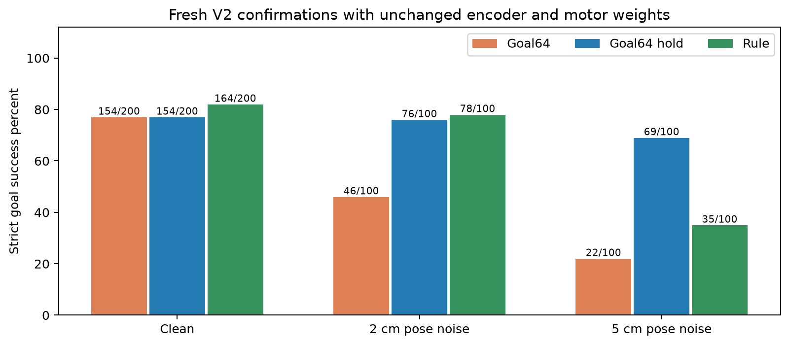
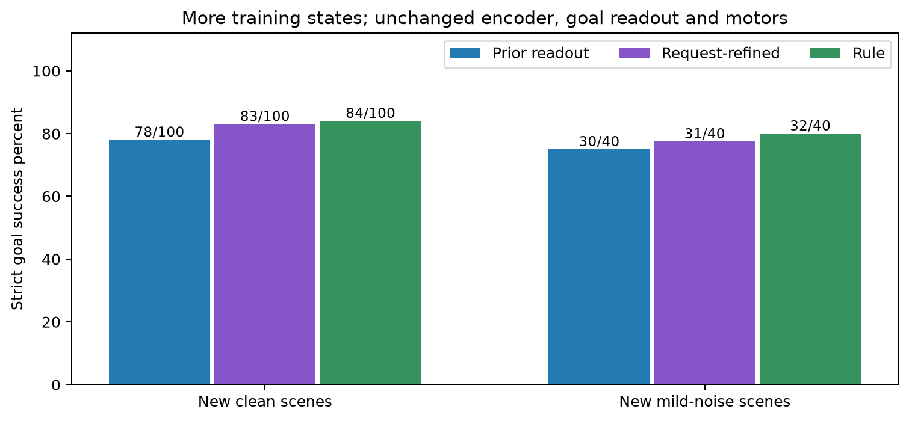
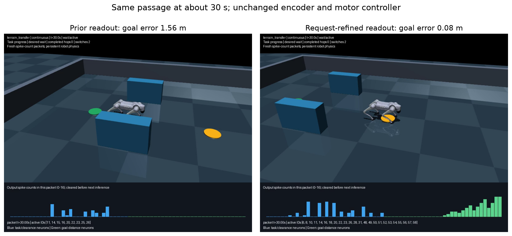

# Terrain and goal transfer assessment

October 17, 2026. Final assessment; generated 2026-10-17T21:10:16+00:00.

Session: 2026-10-17T18:01:40+00:00 to 2026-10-17T21:10:12+00:00; 3.142 hours elapsed.

The original terrain/goal benchmark improved from **0/60 to 44/60**
with the new experimental goal controller. A non-spiking rule control achieves
44/60 on the same course. This is useful progress,
but terrain transfer is not solved and these results do not establish an SNN advantage.
The original 60 scenes informed development; the fresh tests below assess transfer.

The retained experimental revision is **V3**. Additional request-association
data improves fresh clean goals from **78/100
to 83/100**, and noisy goals from
**30/40 to 31/40**,
with the encoder, goal-hold logic and motors unchanged. Every previously
successful regression case is preserved. Known terrain contacts and biased
goal observations remain unresolved.


## Measured results

| Original 60 scenes | Successful tasks | What changed |
| --- | --- | --- |
| Previous 80-neuron selector, original motor | 0/60 | Preserved baseline replay |
| New 64-neuron selector, original motor | 19/60 | Representation, request labels and count associations |
| Goal64, terrain motor profile | 44/60 | Explicit arrival, geometry and bounded gait adaptation |
| Goal64 hold, same terrain profile | 44/60 | Two-packet goal commitment and release |
| Rule goal control, same terrain profile | 44/60 | Matched classical comparator |

The original progress requirement remains 1.55 m with its existing 1 cm scoring
tolerance. Goal-controller rows additionally require a supported goal stop;
failed long traversals were not relabelled as successful shorter goals.
There are no contacts or falls in this completed original-course comparison.

Fresh frozen V2 confirmations compare identical geometries and noise seeds:

| Condition | Goal64 V1 | Goal64 hold V2 | Rule | Contacts/falls, V1 / V2 / rule |
| --- | --- | --- | --- | --- |
| Clean observations | 154/200 | 154/200 | 164/200 | 0/0 / 0/0 / 0/0 |
| 2 cm pose noise, 0.02 rad yaw noise | 46/100 | 76/100 | 78/100 | 0/0 / 0/0 / 0/0 |
| 5 cm pose noise, 0.05 rad yaw noise | 22/100 | 69/100 | 35/100 | 0/0 / 0/0 / 0/0 |

Clean uses seed 15100 and up to 200 scenes. Mild repeats its first 100
geometries; severe uses 100 different scenes from seed 15101. Thus the planned
confirmation has **300 distinct geometries**, not 400. Obstacle position,
velocity and delay perturbations are respectively 3 cm, 0.015 m/s, 100 ms for
mild, and 8 cm, 0.05 m/s, 200 ms for severe. Selector pose is noisy; low-level
waypoint feedback and physical guards retain true simulation state. Geometry
families share procedural templates, so these are not independent real-world trials.

In paired mild-noise scenes, V2 gains 30 successes over V1 with no lost V1
successes. In severe noise it gains 49 and loses two: those two still reach
and hold the goal, but take 6.164 s and 6.740 s after first arrival, exceeding
the unchanged six-second limit. They remain failures. The stateful readout
improves robustness without making every individual scene better.
The rule control retains its own goal thresholds and does not use V2's
two-packet count commitment. These comparisons do not isolate spiking from
temporal filtering; a matched non-spiking filter remains a useful control.

An additional frozen-model diagnostic adds a constant error only to the
longitudinal goal-vector input. It repeats 20 new flat scenes under four
biases, with clearance masks, lateral goal, physical guards and low-level
position feedback unchanged. It is a stopping-decoder test, not a full
localization-stack simulation or another 80 independent environments.

| Constant goal-vector bias | Goal64 V1 | Goal64 hold V2 |
| --- | --- | --- |
| -8 cm | 0/20 | 0/20 |
| -4 cm | 4/20 | 3/20 |
| +4 cm | 20/20 | 20/20 |
| +8 cm | 13/20 | 20/20 |

Persistent input error can make a stable stop occur at the wrong true goal
distance. Hysteresis cannot substitute for an accurate localization estimate.



The larger V1-only confirmation has 780/1000 strict goals,
against 846/1000 rule and 0/1000
previous-selector successes under the same motor profile. Its separate mild
and severe perturbation runs score 56/100 and
21/100, against 82/100 and
34/100 rule. Those noise failures motivated V2; they are
development evidence for V2, not independent confirmation of that iteration.
No model parameters changed after the corresponding release freeze.
The larger run records 1 SNN contacts
and 1 rule contacts, with
0 SNN falls. In scene 723, both controllers
produce bit-identical motion and the front-left calf contacts a step at
8.392 s. This ordinary-range failure reinforces the whole-leg-clearance limit.
The previous selector was trained for request streams, without this goal-stop
contract. Its result measures a missing capability, not a fair architecture
benchmark against a model trained for that capability.

## Why the original selector failed

Baseline progress packets produced 6,742 wait proposals, 4,269 unknown patterns
and 1,049 run proposals. Unknown patterns led to conservative fallback. Even
the flat scene moved partway, then encountered unsupported patterns with the
teacher still requesting run. The failure was not simply that the robot could
not generate torque on rough ground.

Task intent, room/goal context and physical terrain capability needed separate
treatment. The new base population encodes explicit progress/hold/jump intent
and current/predicted clearance. Goal proximity has its own population. This
is an engineered representation change, not a claim that adding arbitrary
random neurons fixes generalization.
The ridge readout generalizes beyond stored prototype matches; its normalized
scores are not calibrated probabilities of physical success. Existing motor,
clearance and handoff guards remain necessary.

The research suggested three practical changes. Goal-conditioned learning
motivates preserving an explicit goal contract and unseen-goal tests
([UVFA](https://proceedings.mlr.press/v37/schaul15.html)). Learner errors change
the states encountered, motivating labels on learner-visited training states
([DAgger](https://proceedings.mlr.press/v15/ross11a.html)). Hysteresis motivates
separate entry/release evidence under noisy observations
([Hespanha et al.](https://www.sciencedirect.com/science/article/pii/S0005109802002418)).
These principles informed our implementation; we did not reproduce those
algorithms or inherit their theoretical guarantees.

## What runs now

The new package is opt-in under `experiments.terrain_goal`; the earlier
continuous-SNN runtime is preserved. A 64-cell frozen LIF encoder runs 16
numerical updates per fresh 100 ms observation packet. Membranes and counts
start at zero every packet. IDs 0–31 encode task/clearance through seeded
random weights; IDs 32–63 use deliberately structured monotonic goal-proximity
channels at eight distance scales. Seed and array checksums are saved.
Explicit hold requests retain the older zero-goal-vector convention, so
goal-proximity analyses use progress packets.

A ridge decoder associates counts with wait/run/jump. A training-fitted goal
count threshold of **92** can replace run with wait. V2 commits that hold after
two fresh entry packets and releases after two fresh packets below **25**,
calibrated at the existing 0.16 m resume boundary. Duplicate timestamps do not
advance confirmation. Task changes and episode reset clear the hold state.
This persistent readout state is separate from resettable neuron state.

The SNN selects skills; it does not generate joint torques. Existing checked
braking, eligibility, commitment and recovery remain underneath. Joint-target
control runs at 100 Hz and bounded PID/physics at 500 Hz. Wait/run remain at
24 Nm; the existing short hop remains at 28 Nm. The separate 72 Nm low-bar
jump is excluded. No motor policy was trained.

The classical terrain profile uses a 0.8 s gait, 70% stance and 12 cm swing
lift, bounded braking, and conservative robot-disc clearance against oriented
boxes. A latched check refuses sampled up-steps above 5 cm. That scan limit
is not a physical guarantee for arbitrary 5 cm terrain. Goal direction remains
classical feedback. Observations are privileged MuJoCo state and maps, not
raw robot-camera images.
Progress/hold/jump mission requests are supplied externally. A jump request is
not yet inferred directly from seeing an obstacle; these results qualify a
skill-request and goal-stopping system, not autonomous visual jump planning.

Strict success requires goal error at most 0.12 m, all feet supported, stopped
gait, linear speed below 0.04 m/s, angular speed below 0.2 rad/s, tilt below
12 degrees and 0.8 s stable wait **during a progress mission**. That wait must
occur within six seconds of first entering the goal region, with no subsequent
departure beyond 0.16 m during progress. An end-of-episode timed stop cannot
substitute for the neural stopping decision. Always-run and always-wait
negative controls each passed **0/30**; stale-input controls passed **0/20**
tasks while remaining standing without contacts or falls.

## Ideas retained and discarded

In matched 20-scene representation/data ablations, a Gaussian goal population
scored **16/20** using teacher-only data and **20/20** after adding labels from
learner-visited states. The monotonic count model scored **20/20** with either
data set; both variants produced bit-identical physics on all 20 scenes and
the same threshold. The goal-threshold release therefore keeps the smaller
teacher-only set; the later request-decoder refinement uses separate learner-state data.
High packet classification accuracy alone had failed to predict goal success.

V1/V2 portable training contains 38,824 base request rows and 32,743 near-goal count
rows. These are teacher preferences, not verified counterfactual outcomes for
every alternative skill. Historical static “skill completed” labels were
excluded from this request decoder. Final test scenes were not used for fitting.

Height-offset and preview adapters caused contacts and were excluded. The
first gait grid completed 216 episodes; the harder grid completed 48 full
settings plus two scenes of setting 49, then stopped on an unreachable FR
foot target. Fifteen later settings were not run. Its failure remains saved.
The imported HIM motor policy was diagnostic, not selected; no new external
weights were downloaded. Its original license must not be inferred from the
wrapper license. Failed traces remain available; they are excluded from the
recommended runtime rather than deleted.

## Targeted request-readout refinement

V2's clean test had ten passage/crossing failures where rule control succeeded.
In a logged passage, the SNN repeatedly requested wait with run eligible and
0.229 m predicted clearance. This motivated a single new-data candidate with
the same encoder, alpha, goal count thresholds, hold logic, gait and limits.
V2 final scenes are development evidence for this iteration.

Twenty new seed-15400 training scenes supplied 16,525 additional causal
request labels on learner/rule trajectories. Goal-hold labels were kept out
of this task-only decoder. The base training set grows from 38,824 to 55,349
rows. Validation uses separate seeds 15401–15403; confirmation uses 15500 and
15501. No confirmation data were used to fit or retune the candidate.

| Check | Prior readout | Request-refined candidate | Rule |
| --- | --- | --- | --- |
| New validation, 40 scenes | 24/40 | 27/40 | 27/40 |
| Existing request regression, 160 scenes | 150/160 | 150/160 | 150/160 |
| Original course regression, 60 scenes | 44/60 | 44/60 | 44/60 |
| New clean confirmation, 100 scenes | 78/100 | 83/100 | 84/100 |
| New mild-noise confirmation, 40 scenes | 30/40 | 31/40 | 32/40 |

Qualification status: **qualified**. Confirmation status:
**retained**. The request-refined V3 candidate meets the declared retention gates. The unchanged demo defaults to V2; choose V3 explicitly with `--model docs/agents/terrain_goal_v3/primary.npz`.
The fresh paired results add five clean and one noisy success, with none of
the prior successful cases lost in either comparison.
The prior request-regression reference is the existing Goal64 readout with
goal mode disabled; the other new rows are paired with V2. These are distinct
cohorts and cannot be added together as independent success counts.
The [refinement protocol](terrain_goal_request_refinement_protocol.md) records
gates, deadlines, paired-regression requirements and the data split.
The candidate also reproduces all three known calf contacts with bit-identical
physics at shared ticks. This negative control confirms that better request
associations did not fix the unchanged terrain motor controller.



At 7.1 s in a repeated fresh passage example, both models received identical
features and the same active-neuron/count packet, `{11: 10, 14: 5, 15: 1, 16: 6, 20: 4, 22: 5, 23: 3, 25: 3, 26: 8}`. The prior
readout chose wait; the refined readout chose run, matching the eligibility
teacher. The paired full episode ended 1.56 m from the goal for the prior
model and 0.08 m for the refined model. The encoder did not change; the
learned association did. This selected demonstration is not another independent scene.




## Remaining failures and next work

Four original cross-slope cases remain terrain refusals. All six moving-crossing
and six mixed-course cases still miss supported goal arrival within the
original mission window. Extra elapsed time is not counted as original success.
The model needs better physical terrain capability and route/timing decisions,
not merely more associations for the same motion.

Wider-goal/low-friction OOD evaluation scores **74/100 V1**,
**80/100 rule**, and **74/100 frozen V2 diagnostic**.
These repeat the same 100 scene definitions: goals 2.7–4.2 m, yaw up to
0.45 rad, floor friction 0.4–0.7 and taller terrain. Retain contact failures.
One rule execution was interrupted without a terminal record; its exact paired
replay passed, with the SNN replay bit-identical at shared recorded ticks.
The partial attempt remains saved and the matched replay replaces that scene
in the paired table. It is not an extra independent environment.

In OOD case 14, the rear-left calf contacts an uneven block at 11.990 s.
V1, V2 and rule controls reproduce the same pre-goal failure. A foot-lift-only
controller lacks whole-leg clearance planning. The next motor milestone should
check body/leg swing clearance and reachable footholds, with a separate
`terrain_walk` contract. Joint body/foothold planning in
[TAMOLS](https://arxiv.org/abs/2206.14049) is relevant research, not an implemented
feature here. Moving obstacles also need a tested wait/detour option with
explicit deadlines. Detailed proposed contracts and research alternatives are
in the [research brief](../../experiments/terrain_goal/research.md).
OOD case 93 also contacts a step with the front-left calf at 8.386 s.
Both contact cases have bit-identical recorded physics across V1, V2 and rule
control; all three have two contacts and zero falls over their 100 OOD scenes.

## Validation and reproduction

All **194 project tests passed** after the bias-diagnostic checks were added.
All three frozen models reconstruct byte-for-byte from the
published training records. Seven torque-only replays (three goal demos, three
run/jump/cancellation scenes and one failed terrain-contact episode) reproduced
**75,311 physics steps** with zero position/velocity error. All **17 handoffs**
had four loaded feet. Replaying a failure validates its recording, not task
success. Three paired run/jump/interruption scenes passed with bit-identical
V1/V2 physics, showing the goal latch did not change those actions.
Extracted source/model/training/robot-asset archives also rebuilt V2 and V3
byte-for-byte and reproduced their full steps-demo trajectories bit-for-bit using
the existing project Python dependencies. This checks archive portability;
it is not a fresh dependency installation or another independent scene.

The final audit checked 9,996 saved episodes, 34,786 handoffs and 2,123,417 exact sequential packet predictions. It recorded 0 integrity failures, 0 source snapshot failures and 0 model-load errors. All 51 preserved baseline hashes match.

Independent goal-stop calculations from recorded traces and supervisor events
agreed on **5,142/5,143** checked episode scores. Termination/contact/fall flags
remain those recorded by the executor; this is not independent physics replay
of every episode. The sole discrepancy was a rule stop at the six-second boundary:
5.986 s at runtime versus 6.020 s from coarse sampling. An exact full-rate
replay reproduced the original states at shared ticks, and independent 2 ms
scoring confirmed 5.986 s. No original acceptance score was changed.

The first gait-search process predates immutable source capture: its first
candidate bundle represents the loaded runtime. Later per-candidate on-disk
snapshots are not asserted to be live imports. The hard grid and final batches
capture one immutable source bundle per process. This provenance limitation
does not apply to the frozen final comparison.

There are **9,996 terminal episode logs** across
training, development, controls, repeated replays and assessments. These are
not that many distinct worlds or successful tasks. The report's paired tables
use the declared cohorts and preserve failures. Source/model manifests,
cases, packet counts, decisions, handoffs, torques, failed-task CSVs and
attempt accounting are under `output/terrain_goal/`.
The verified source/model/training bundle is
`output/terrain_goal/final-source-release/source-and-assets.zip`; its adjacent
`verification.json` records frozen hashes and Python/package versions.

```powershell
.venv-win/Scripts/python.exe -m experiments.terrain_goal.demo --scene steps --viewer --video
.venv-win/Scripts/python.exe -m experiments.terrain_goal.demo --scene noisy_goal --viewer --video
.venv-win/Scripts/python.exe -m experiments.terrain_goal.package_v2 --reproduce output/terrain_goal/my-reproduction
.venv-win/Scripts/python.exe -m experiments.terrain_goal.package_refinement --reproduce output/terrain_goal/my-v3-reproduction
.venv-win/Scripts/python.exe -m experiments.terrain_goal.evaluate_release --phase clean --output output/terrain_goal/my-v3-confirmation
```

Use a new output directory for reproduction. Demos perform inference and
record execution; they do not train in the background. The V2 model is
`docs/agents/terrain_goal_v2/primary.npz`, semantic checksum
`d2b7c1f9d000cdf9594042237fd6576e52e501bcd67cb63178bddd41d7edfae1`.
The retained request-refined V3 checkpoint is
`docs/agents/terrain_goal_v3/primary.npz`, checksum
`b2dcc0e47c62a98896bed3e9108f5534988594fc806535c98cf5baa216d01841`.
The [package README](../../experiments/terrain_goal/README.md) documents units,
contracts and replay commands. Simulation results do not certify hardware or
establish superiority over non-spiking controllers.
